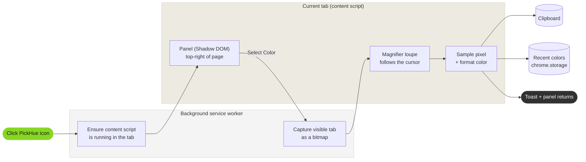

# PickHue

## An elegant, in-page color picker for your browser.

PickHue lets you grab any color on any page with a precise on-screen magnifier, copies it to your clipboard in the format you want, and keeps a tidy history of recent colors — all from a clean panel that lives right on the page.

**Free. Open source. No accounts. No tracking. Nothing leaves your machine.**

> [!NOTE]
> As of **3.2.0**, installing PickHue shows **no site-access warning**. It runs on `activeTab` alone — access is granted when you click the icon and revoked when the tab navigates away. See [store/PERMISSIONS.md](store/PERMISSIONS.md).

---

## Features

- 🎯 **Pixel-precise eyedropper** — a circular magnifier loupe follows your cursor so you pick the exact pixel you mean.
- 📋 **Seven formats** — HEX, RGB, HSL, OKLCH, LCH, OKLAB, and HWB. Picks are copied automatically on click; right-click any swatch to copy it in a different format.
- 🔬 **Area-average sampling** — press `S` while picking to cycle 1×1 / 3×3 / 5×5 averaging for photos and antialiased edges.
- 🕘 **Recent colors** — every pick is saved; click any swatch to copy it again, and scroll the row for older picks.
- 🎨 **Saved palettes** — group colors into named palettes; reorder, import, and export as hex list, CSS variables, Tailwind config, Adobe ASE, or JSON.
- 🪄 **Color Card** — every palette swatch opens a card with OKLCH tune sliders and a 10-step shades & tints ramp. Stage the steps you want and commit them together.
- ♿ **Contrast checker** — WCAG ratios and AAA / AA grades against white, black, and every other color in the palette, updating live as you tune.
- ✨ **Palette from this page** — one click gathers the page's colors grouped into backgrounds, text, and borders, with near-duplicates merged perceptually.
- 💅 **Wears your colors** — the whole UI derives its accent from your last pick, computed in OKLCH so every hue stays vibrant and the text stays legible.
- ⌨️ **Keyboard** — `Alt+Shift+P` starts the eyedropper (remappable), arrow keys nudge one pixel (`Shift` = 10), `Enter` picks, `Esc` cancels.
- 🌗 **System, light & dark** — match your OS or pick a fixed theme.
- 🪟 **Real rounded UI** — the interface is injected into the page (like Pocket and Prod), so it gets true rounded corners and shadows instead of the browser's boxy popup.
- 🔒 **Private by design** — the page is sampled locally; no servers, no third parties.

---

## Install

> Install from the [Chrome Web Store](https://chromewebstore.google.com/) (search **PickHue**), or load a release zip / build from source below.

**Quick install (developer / GitHub)**

1. Download the latest `pickhue-*.zip` from [Releases](https://github.com/alex-wilczewski/pickhue/releases/latest) — every release zip is built by CI from its tagged commit
2. Unzip the archive
3. Open `chrome://extensions` (or `brave://extensions`)
4. Enable **Developer mode** → **Load unpacked** → select the unzipped folder (must contain `manifest.json`)
5. Pin PickHue from the toolbar puzzle menu

**Build from source**

```bash
git clone https://github.com/alex-wilczewski/pickhue.git
cd pickhue
npm install
npm run build
```

Then load the `dist/` folder as above.

---

## How to Use

**TLDR:** Click the PickHue icon (or press `Alt+Shift+P`) → click any pixel → it's copied.

**1. Open the panel**
Click the PickHue icon in your toolbar. The panel slides in at the top-right of the page.

**2. Start picking**
Click **Select Color**. The panel steps aside and a magnifier loupe appears under your cursor. `Alt+Shift+P` skips straight to this step.

**3. Pick a color**
Move to the pixel you want and click. The color is copied to your clipboard, a toast confirms it, and it's added to the front of **Recent Colors**. Press `S` to average a 3×3 or 5×5 area, arrow keys to nudge by a pixel, and **Esc** to cancel without picking.

**4. Reuse colors**
Click any recent swatch to copy it again, or right-click it for the same color in any other format. Scroll the recent-colors row (just hover and scroll) to reach older picks.

**5. Palettes**
Press **+** in **Saved Palettes** to make one — from your current selection if you have swatches selected — or tap **+** on the copy toast right after a pick. The ✨ action builds a palette from the colors already on the page. Open any palette to rename, reorder, import, or export it.

**6. Tune and check**
Click a swatch inside a palette to open its **Color Card**: OKLCH sliders, a shades & tints ramp you can stage steps from, and a contrast section with WCAG grades against white, black, and the rest of the palette.

---

## Where It Works

The panel and eyedropper run as a content script injected into the page, so they work almost everywhere — but not on pages the browser locks down.

| | Examples |
|---|---|
| **Works** | Regular websites — marketing sites, docs, apps, dashboards, local pages |
| **Can't run** | Browser-internal pages (`chrome://`, `brave://`), the Web Store, and other extension pages |

> [!NOTE]
> On a page where PickHue can't run, clicking the toolbar icon briefly shows an **n/a** badge instead of opening the panel.

> [!TIP]
> Because PickHue asks for no standing site access, its permission to read a tab ends when that tab navigates. If you follow a link with the panel open, click the icon again (or press `Alt+Shift+P`) on the new page.

---

## How It Works



A few details that make it feel right:

- **Shadow DOM isolation.** The panel renders inside a shadow root so the host page's CSS can never leak in and break the design.
- **Accurate sampling.** Clicking the icon captures the visible tab, and the loupe magnifies that bitmap — so the pixel under the reticle is exactly what gets copied.
- **The bitmap wins.** A DOM probe reads computed CSS to beat the screenshot on antialiased text and sub-pixel rounding, but it stands down the moment something paints its own pixels — images, canvases, gradients, SVG — because there the screenshot is ground truth.
- **Gesture-safe clipboard.** The copy happens synchronously inside your click, so it works reliably even when the page isn't focused.

---

## Development

```bash
npm run dev        # rebuild on change (load dist/ as an unpacked extension)
npm run build      # production build into dist/ (icons + content script)
npm run typecheck  # type-check without emitting
npm test           # run the test suite once
npm run test:watch # run it on change
npm run package    # build, verify the manifest, and zip for the Web Store
```

Every push and pull request runs typecheck, tests, and a build in [CI](.github/workflows/ci.yml), which finishes by asserting the built manifest still requests no host permissions. Pushing a version tag (`3.2.0`) builds and publishes a GitHub release with the zip attached.

### Project structure

```
src/
  background/service-worker.ts   # toolbar click → toggle panel; tab capture; saves recents
  content/
    index.ts                     # content entry: wires the panel + eyedropper
    panel.ts / panel.css         # the in-page UI (Shadow DOM)
    palette-editor.ts            # palette editor sub-view
    palette-menu.ts              # palette picker / action menus
    picker.ts / picker.css       # the eyedropper magnifier overlay
  shared/
    accent.ts                    # derives the UI accent from your last pick (OKLCH)
    colors.ts                    # conversions + the exact strings that get copied
    dom-color.ts                 # CSS probe under the cursor; defers to the bitmap
    palette-io.ts                # import / export (JSON, ASE, CSS, Tailwind)
    *.test.ts                    # vitest suites, run by `npm test`
  manifest.ts                    # MV3 manifest
scripts/
  generate-icons.mjs             # builds PNG icons from the logo SVG
  check-manifest.mjs             # fails the build if the permission set changes
  package-extension.mjs          # zips dist/ for the Web Store
public/icons/logo-mark.svg       # source logo mark
store/                           # Web Store listing copy, permissions rationale
```

### Customizing the logo

The logo mark lives at `public/icons/logo-mark.svg`. The toolbar/extension PNGs are generated from it during the build, so just replace the SVG and run `npm run build`.

---

## Permissions

| Permission | Why |
|---|---|
| `activeTab` | Capture the visible page so colors can be sampled pixel-accurately. Granted only when you click the icon or press the shortcut, and revoked when the tab navigates away. PickHue declares **no** `host_permissions`, so installing it shows no site-access warning — see [store/PERMISSIONS.md](store/PERMISSIONS.md) |
| `scripting` | Inject the panel/eyedropper on pages that were already open before install |
| `storage` | Persist your settings, recent colors, and saved palettes |

No network access, no remote code, no analytics. Your palettes and settings live in `chrome.storage.sync`, which is between you and your browser.

---

## Releases

[CHANGELOG.md](./CHANGELOG.md) has the full history. Recent highlights:

- **3.2.0** — no site-access warning on install; the original green returns as the default accent; neutral picks drive the UI properly; correct colors over images, gradients, and canvases
- **3.1.0** — Color Card, contrast checker, palette from this page, area-average sampling, three more formats
- **3.0.0** — dynamic accent, keyboard shortcut, palette editor overhaul, shades & tints
- **2.0.0** — saved palettes

---

## Contributing

Issues and pull requests are welcome — see [CONTRIBUTING.md](./CONTRIBUTING.md) for how to run it locally, what the tests cover, and which bits of the design are deliberate. For anything larger than a fix, opening an issue first is the quickest route.

---

## Tech

TypeScript · Vite · [`@crxjs/vite-plugin`](https://github.com/crxjs/chrome-extension-tools) · Manifest V3 · Shadow DOM · Vitest · `sharp` (icon generation)

---

## License

[MIT](./LICENSE) — free to use, fork, and learn from.
